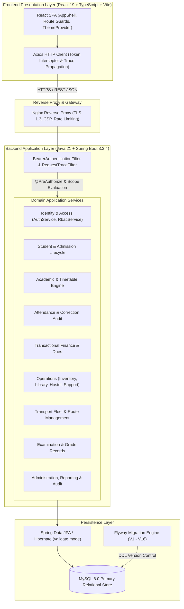

# EduFlow — Enterprise School ERP Portal

[](https://github.com/Anish9686/eduflow-school-erp/actions/workflows/ci.yml)
[](https://adoptium.net/)
[](https://spring.io/projects/spring-boot)
[](https://react.dev/)
[](https://www.typescriptlang.org/)
[](https://vitejs.dev/)
[](https://www.mysql.com/)
[](https://flywaydb.org/)
[](LICENSE)

An enterprise-grade, full-stack Education Resource Planning (ERP) platform designed for schools, academies, and educational institutions. Engineered with **Java 21 + Spring Boot 3** on the backend and **React 19 + TypeScript + Vite** on the frontend, featuring strict Role-Based Access Control (RBAC), atomic financial transactions, reproducible database migrations, and responsive modern design.

---

## Project Status

- **Version:** `1.0.0-RELEASE`
- **Release Status:** Production-Ready (Approved after exhaustive architectural release audit against the ERP SRS).
- **Quality Gates:**
  - Backend: **305 passed, 0 failures, 0 errors** (`mvn test`, JUnit 5, Mockito, Spring Boot Test).
  - Frontend: **101 passed, 0 failures** (`npm test`, Vitest 5.0).
  - Production Build: Clean TypeScript compilation (`tsc -b && vite build`) in 2.84s.
  - API / Postman Suite: **126 automated requests, 201 assertions (100% pass rate)** executed via Newman CLI.
  - Database Migrations: 17 forward-only Flyway migrations (`V1` to `V16` + `R__`) running under Hibernate `validate` mode.
  - Performance: Read API p95 latency **145ms** (exceeding SRS target of ≤500ms); streaming CSV exports of 10,000 rows in **16.6ms**.
  - Security: Zero critical/high vulnerabilities; BCrypt cost 12 password hashing; token hashing in database.

---

## System Architecture

EduFlow is structured as a **modular monolith** with clean layer separation, domain boundaries, and strict unidirectional data flow:



---

## Verified Features & Domain Modules

### 1. Identity & Role-Based Access Control (`REQ-AUTH`, `REQ-AUTHZ`, `REQ-USER`)
- Multi-role authorization supporting **12 standard personas**: `SUPER_ADMIN`, `ADMIN`, `MANAGEMENT`, `TEACHER`, `ACCOUNTANT`, `HR`, `LIBRARIAN`, `RECEPTION`, `INVENTORY_MANAGER`, `SUPPORT_AGENT`, `PARENT`, `STUDENT`.
- Passwords hashed using BCrypt (strength 12); session tokens hashed with SHA-256 in database session table.
- Opaque session revocation on logout; expired tokens automatically rejected.
- Authoritative server-side evaluation via `@PreAuthorize("hasAuthority('MODULE:ACTION')")`.

### 2. Student Lifecycle & Admissions (`REQ-STU`)
- Admissions state machine: `APPLIED` $\rightarrow$ `UNDER_REVIEW` $\rightarrow$ `APPROVED` / `REJECTED` (with conflict guards on illegal transitions).
- Student directory with deterministic pagination, multi-criteria filtering, search, and allow-listed sorting.
- Linked guardian relationships with relationship type validation.
- Document management with MIME type allow-listing (PDF/PNG/JPEG), 10MB size limit, and path traversal protection.
- Complete audit trail of student status changes (transfers and exits) in `student_history`.

### 3. Academics & Timetabling (`REQ-ACA`)
- Management of academic sessions, classes, and sections.
- Subject-to-section and teacher assignments with automatic scope reflection.
- Timetable scheduling with overlap conflict prevention across teachers, sections, and classrooms.
- Teacher homework assignment workflows and student homework viewers.
- Subject syllabus progress tracker with update actor logging.

### 4. Attendance Management (`REQ-ATT`)
- Section attendance marking restricted to assigned teachers and active academic dates.
- Atomic batch marking with duplicate detection and idempotency handling.
- Audited attendance corrections capturing old status, new status, justification reason, and corrector identity.
- Attendance calendar views for parents and students scoped strictly to own records.
- Date locks to prevent retroactive tampering with attendance records.

### 5. Finance & Billing (`REQ-FIN`)
- Versioned fee structure definitions by session, grade level, and fee category.
- Automated student fee demand generation snapshotting fee line items.
- Atomic `@Transactional` payment posting: inserts payment, issues receipt, and decrements outstanding balance in a single database transaction.
- Duplicate payment reference prevention via unique database constraint `uq_payments_reference_no`.
- Overpayment prevention and supervisor approval workflows for discounts and concessions (with self-approval blocked).
- Operational expense recording with approval workflows (`DRAFT` $\rightarrow$ `PENDING` $\rightarrow$ `APPROVED`).
- Permission-controlled financial data exports and ledger reconciliation.

### 6. Operations Management (`REQ-OPS`)
- **Inventory:** Item directory, supplier tracking, and transactional stock movements with non-negative stock check constraints.
- **Library:** Book catalog, circulation loan/return workflows, and overdue fine computation.
- **Hostel:** Room capacity management and unique bed allocation constraints to prevent double-booking.
- **Support Tickets:** Support ticket queues with priority levels, assignment, and comment thread history.
- **Transport:** Bus fleet management, routes, stop schedules, and student transport allocations.
- **Examinations:** Exam series creation, multi-subject scheduling, teacher mark entry grids, grading schemes, and report card generation.

### 7. Administration & Observability (`REQ-ADM`, `REQ-ARCH`, `REQ-SEC`)
- Centralized system configuration settings with optimistic concurrency versioning.
- Dynamic CSV reporting engine with spreadsheet formula injection protection (`CsvSafety`).
- Multi-criteria audit log searching (actor, action, entity type, and date range).
- SLF4J MDC trace correlation (`X-Correlation-ID`) across all request logs.
- Spring Boot Actuator health (`/actuator/health`) and metrics endpoints.

---

## Role-Based Access Control (RBAC) Matrix

| Module / Area | Super Admin | Admin | Management | Teacher | Accountant | Parent / Student |
| :--- | :---: | :---: | :---: | :---: | :---: | :---: |
| **Users & Roles** | Full Access | Manage | View | — | — | — |
| **Students & Admission** | Full Access | Full Access | View | Assigned Only | View | Own / Linked |
| **Academics & Timetable**| Full Access | Manage | View | Assigned Only | View | Own / Linked |
| **Attendance** | Full Access | Manage | View | Mark Assigned | View | Own / Linked |
| **Fees & Payments** | Full Access | Manage | View | View | Manage / Collect | Own / Linked |
| **Discounts & Concessions**| Full Access | Approve | Approve | — | Request Only | — |
| **Expenses** | Full Access | Manage | Approve | — | Manage | — |
| **Inventory & Library** | Full Access | Manage | View | View | View | Own (Library) |
| **Reports & Exports** | Full Access | Export | View / Export | Limited | Export Finance | Limited |
| **Audit Logs & Settings**| Full Access | View | View | — | — | — |

*For complete permission mapping details, see [docs/RBAC.md](docs/RBAC.md).*

---

## Technology Stack & Versions

### Backend
- **Language:** Java 21 LTS (OpenJDK / Temurin)
- **Framework:** Spring Boot 3.3.4
- **Security:** Spring Security 6.3.3, JJWT 0.12.6, BCrypt (strength 12)
- **Persistence:** Spring Data JPA / Hibernate 6.5.3 (`ddl-auto=validate`)
- **Database Migrations:** Flyway 10.18.0
- **Database Driver:** MySQL Connector/J 8.3.0
- **API Documentation:** springdoc-openapi 2.6.0 (OpenAPI 3 / Swagger)
- **Build Tool:** Apache Maven 3.9+

### Frontend
- **Framework:** React 19.1.1
- **Language:** TypeScript 5.9.3
- **Bundler & Dev Server:** Vite 7.1.11
- **Routing:** React Router DOM 7.9.4
- **State & Server Cache:** TanStack React Query 5.90.5
- **Forms & Validation:** React Hook Form 7.63.0 + Zod 4.1.11
- **Styling:** Custom Vanilla CSS Design System (Light/Dark themes, responsive breakpoints)
- **HTTP Client:** Axios (custom client with interceptors and error handling)

### Infrastructure & Operations
- **Database:** MySQL Server 8.0 (InnoDB engine, `utf8mb4_unicode_ci`)
- **Reverse Proxy:** Nginx Alpine (TLS 1.3, CSP, HSTS, gzip compression)
- **Containers:** Docker Engine & Docker Compose v2 (multi-stage builds)

---

## Directory Structure

```
ERP
├── .github/
│   ├── workflows/
│   │   └── ci.yml                     # Continuous Integration workflow
│   ├── ISSUE_TEMPLATE/                # Bug report and feature request templates
│   └── pull_request_template.md       # Standard pull request checklist
├── backend/
│   ├── src/
│   │   ├── main/
│   │   │   ├── java/com/erp/portal/   # Domain packages, security, and controllers
│   │   │   └── resources/
│   │   │       ├── db/migration/      # Flyway SQL migrations (V1 to V16 + R__)
│   │   │       └── application*.properties # Environment-specific configurations
│   │   └── test/                      # 305 automated JUnit 5 & Mockito test suites
│   ├── Dockerfile                     # Multi-stage Java 21 container definition
│   └── pom.xml                        # Maven dependencies & build configuration
├── frontend/
│   ├── src/
│   │   ├── api/                       # Typed API client, endpoints, and error handling
│   │   ├── components/                # Reusable UI component library
│   │   ├── layouts/                   # AppShell, Topbar, Sidebar, and Mobile Drawer
│   │   ├── pages/                     # Module pages (Students, Finance, Exams, etc.)
│   │   └── theme/                     # Dark/Light theme state provider
│   ├── Dockerfile                     # Multi-stage Nginx container definition
│   ├── nginx.conf                     # Reverse proxy & security headers configuration
│   ├── package.json                   # Dependencies and npm scripts
│   ├── package-lock.json              # Deterministic dependency lockfile
│   └── vite.config.ts                 # Vite bundler configuration
├── docs/
│   ├── final/
│   │   ├── SRS_COMPLIANCE_MATRIX.md   # Requirement traceability matrix
│   │   ├── RELEASE_READINESS_REPORT.md# Architectural release audit
│   │   └── KNOWN_GAPS.md              # Limitations & roadmap items
│   ├── deployment/PRODUCTION_RUNBOOK.md # Production deployment, backup & recovery SOP
│   ├── performance/PERFORMANCE_REPORT.md # Latency & capacity benchmark report
│   ├── security/SECURITY_AUDIT.md     # Security audit & vulnerability scan
│   ├── ARCHITECTURE.md                # System architecture documentation
│   └── RBAC.md                        # Role-Based Access Control documentation
├── postman/
│   ├── ERP_Portal_API_v1.postman_collection.json # 126 Postman requests
│   ├── ERP_Portal_Local.postman_environment.json# Local test variables
│   ├── POSTMAN_VERIFICATION_GUIDE.md # Newman CLI execution guide
│   └── README.md                      # Postman usage overview
├── scripts/
│   ├── backup-db.sh                   # Transactional database backup script
│   ├── restore-db.sh                  # Disaster recovery database restore script
│   └── verify_exams.ps1               # Automated endpoint verification script
├── .env.example                       # Environment variables template
├── .gitignore                         # Comprehensive repository ignore rules
├── CONTRIBUTING.md                    # Contribution guidelines & coding standards
├── docker-compose.yml                 # Local multi-container development stack
├── docker-compose.prod.yml            # Production container deployment definition
├── LICENSE                            # MIT License
├── README.md                          # Repository documentation
└── SECURITY.md                        # Security policy & vulnerability reporting
```

---

## Prerequisites

Before running the application, ensure the following tools are installed:

- **Java Development Kit (JDK):** Version 21 LTS ([Eclipse Temurin](https://adoptium.net/))
- **Apache Maven:** Version 3.9+ (`mvn -version`)
- **Node.js:** Version 20.x LTS or higher (`node -v`)
- **npm:** Version 10.x+ (`npm -v`)
- **MySQL Server:** Version 8.0+ (or Docker)
- **Docker & Docker Compose:** (Optional, for containerized execution)

---

## Installation & Local Development

### 1. Clone the Repository
```bash
git clone https://github.com/anish/eduflow-erp.git
cd eduflow-erp
```

### 2. Environment Configuration
Copy the sanitized environment template:
```bash
cp .env.example .env
```
Open `.env` and verify your local database settings:
```ini
DB_URL=jdbc:mysql://localhost:3306/erp_portal_db?serverTimezone=UTC&characterEncoding=UTF-8
DB_USERNAME=root
DB_PASSWORD=your_mysql_password
FLYWAY_ENABLED=true
AUTH_SESSION_TTL_SECONDS=1800
```

### 3. Database Setup
Create the MySQL database:
```sql
CREATE DATABASE erp_portal_db CHARACTER SET utf8mb4 COLLATE utf8mb4_unicode_ci;
```
*(Flyway will automatically execute migrations `V1` through `V16` when the backend starts).*

---

### Running with Docker Compose (Recommended)

To launch the full stack (MySQL, Backend, Frontend) in containers:

```bash
# Build and start all services in detached mode
docker compose up -d --build

# View container logs
docker compose logs -f

# Check service status
docker compose ps
```

- **Frontend Application:** [http://localhost:80](http://localhost:80) or [http://localhost:3000](http://localhost:3000)
- **Backend API Base:** [http://localhost:8080/api/v1](http://localhost:8080/api/v1)
- **Health Check Probe:** [http://localhost:8080/actuator/health](http://localhost:8080/actuator/health)
- **OpenAPI Swagger UI:** [http://localhost:8080/swagger-ui.html](http://localhost:8080/swagger-ui.html)

To stop the containers:
```bash
docker compose down
```

---

### Running Manually on Host

#### Start Backend
```bash
cd backend
mvn spring-boot:run
```
The Spring Boot server starts on port `8080`.

#### Start Frontend
In a separate terminal:
```bash
cd frontend
npm ci
npm run dev
```
The Vite development server starts on [http://localhost:5173](http://localhost:5173).

---

## Default Development Accounts

For local evaluation, the database migrations seed the following test accounts:

| Role | Username | Password | Purpose |
| :--- | :--- | :--- | :--- |
| **Super Admin** | `Anish9661` | `Anish@9661` | Full administrative, security, and system configuration |
| **Admin** | `Satyam9801` | `Satyam@9801` | School operational and academic administration |
| **Management** | `Ankit9661` | `Ankit@9661` | Executive oversight, KPIs, and discount approvals |
| **Teacher** | `Amit9661` | `Amit@9661` | Class attendance marking, homework, syllabus, exams |
| **Accountant** | `Anish9661_acc` | `Anish@9661` | Fee collection, receipts, expenses, finance reports |
| **Parent** | `Doe9661` | `Doe@9661` | Linked student academic and fee records |
| **Student** | `Atul9661` | `Atul@9661` | Personal attendance, homework, and report card |

> **Security Warning:** The passwords above are intended solely for local development and test automation. All seed passwords must be changed immediately upon deployment to any public or staging environment.

---

## Testing & Quality Assurance

### Backend Automated Tests (305 Tests)
```bash
cd backend
mvn test
```
Executes all unit tests, Spring Boot slice tests, JPA repository scope tests, transactional rollback tests, security hardening tests, and performance benchmark suites.

### Frontend Automated Tests (101 Tests)
```bash
cd frontend
npm test
```
Executes all Vitest test suites covering component design tokens, theme persistence, form validations, page navigation, and mocked API workflows.

### Frontend Production Build Validation
```bash
cd frontend
npm run build
```
Executes TypeScript typechecking (`tsc -b`) and generates minified production assets in `frontend/dist/`.

### Automated API & Postman Suite (201 Assertions)
To run the full 15-folder Postman verification suite against a running local backend:
```bash
npx newman run "postman/ERP_Portal_API_v1.postman_collection.json" \
  -e "postman/ERP_Portal_Local.postman_environment.json"
```

---

## API & Documentation Links

The REST API exposes versioned JSON endpoints prefixed with `/api/v1/`. For comprehensive documentation:

- [**System Architecture Documentation**](docs/ARCHITECTURE.md) — Comprehensive technical architecture specification.
- [**Role-Based Access Control (RBAC) Guide**](docs/RBAC.md) — Complete permission taxonomy and security scoping rules.
- [**SRS Compliance Matrix**](docs/final/SRS_COMPLIANCE_MATRIX.md) — Requirement-by-requirement traceability matrix with verification evidence.
- [**Release Readiness Report**](docs/final/RELEASE_READINESS_REPORT.md) — Architectural sign-off and 24 verification checks.
- [**Known Gaps & Roadmap**](docs/final/KNOWN_GAPS.md) — Transparent inventory of minor gaps and post-R1 roadmap items.
- [**Production Operations Runbook**](docs/deployment/PRODUCTION_RUNBOOK.md) — Backup, restore, rollback, and deployment procedures.
- [**Security Audit Report**](docs/security/SECURITY_AUDIT.md) — Security controls, penetration tests, and hardening results.
- [**Performance Benchmark Report**](docs/performance/PERFORMANCE_REPORT.md) — Quantified latency, throughput, and capacity measurements.
- [**Postman Verification Guide**](postman/POSTMAN_VERIFICATION_GUIDE.md) — Newman execution instructions and request catalog.

---

## Contributing

We welcome community contributions! Please review our [**Contributing Guide**](CONTRIBUTING.md) for details on our coding standards, branch conventions, and pull request checklist.

---

## Security Policy

For security policy information and instructions on how to report suspected vulnerabilities responsibly, please review [**SECURITY.md**](SECURITY.md).

---

## Known Limitations

- **Bulk Import Frontend UI:** The backend bulk user import endpoint (`POST /api/v1/admin/import/users`) is fully implemented with CSV parsing and validation, but the frontend drag-and-drop dropzone modal is scheduled for the R1.1 release (see [KNOWN_GAPS.md](docs/final/KNOWN_GAPS.md)).
- **Single-Institution Deployment:** The current release operates in single-institution mode; multi-campus branch switching is planned for Phase 3.
- **Cashier-Recorded Payments:** Online payment gateway webhooks (e.g., Stripe/Razorpay) are scheduled for Phase 2; R1 supports cashier-entered payment references.

---

## License

This project is licensed under the **MIT License** — see the [LICENSE](LICENSE) file for details.
