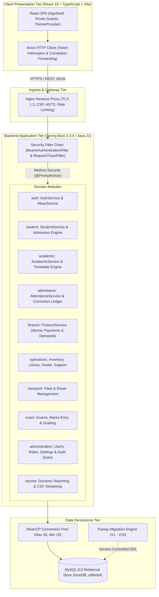

# EduFlow ERP Portal — Technical Architecture Specification

**Document Version:** 1.0.0-RELEASE  
**Status:** Approved / Realized  
**Architecture Style:** Modular Monolith  
**Authoritative Baseline:** Java 21 LTS + Spring Boot 3.3.4 | React 19 + TypeScript 5.9 + Vite 7 | MySQL 8.0  

---

## 1. Executive Architecture Overview

EduFlow is an enterprise-grade School Enterprise Resource Planning (ERP) platform designed for educational institutions. The platform is architected as a **modular monolith** with clear domain boundaries, layered abstraction, strict unidirectional dependencies, and server-authoritative security controls.

### Core Architectural Invariants:
1. **Decoupled Client-Server Separation:** The frontend is a Single Page Application (SPA) communicating exclusively via versioned HTTP JSON REST endpoints (`/api/v1/*`). No direct database sockets, JDBC credentials, or MySQL queries exist in the frontend layer.
2. **Authoritative Backend Security:** Client-side route guards and navigation hiding are treated as usability conveniences. All security authorization decisions are authoritatively evaluated server-side using Spring Security `@PreAuthorize("hasAuthority('MODULE:ACTION')")` and repository query data scoping.
3. **Migration-Controlled Persistence:** Database schema is controlled exclusively via forward-only Flyway migrations (`V1` through `V16`). In production, Hibernate is configured with `ddl-auto=validate`, strictly preventing automatic DDL generation or alteration at runtime.
4. **DTO / Entity Separation:** Domain entities and persistence models are completely isolated within service and repository layers. Controllers exclusively consume and return typed Java records and DTOs.
5. **Deterministic Error Contract:** All API errors adhere to a unified JSON error schema containing timestamps, HTTP status, stable error codes, messages, request paths, validation field error arrays, and distributed trace IDs.

---

## 2. System Architecture Diagram



---

## 3. Backend Architecture & Package Taxonomy

The backend codebase (`backend/src/main/java/com/erp/portal`) is organized into domain modules with explicit responsibilities:

```
com.erp.portal
├── academic/           # Sessions, classes, sections, subjects, timetable conflict engine, homework, syllabus
├── administration/     # User lifecycle, role/permission editor, system settings versioning, CSV import/export
├── attendance/         # Section attendance marking, duplicate prevention, date locks, correction history
├── auth/               # Authentication, token generation, database session management, RBAC resolution
├── common/
│   ├── api/            # ApiErrorResponse, GlobalExceptionHandler, RequestTraceFilter, PageableValidator
│   ├── config/         # SecurityConfiguration, WebMvcConfig, JacksonConfig
│   └── export/         # CsvSafety (spreadsheet formula injection sanitizer)
├── dashboard/          # Role-tailored KPI calculation and aggregate metric retrieval
├── exam/               # Exam series, scheduling, mark entry grids, grading schemes, report cards
├── finance/            # Fee structures, dues, atomic payment/receipt collection, discounts, expenses
├── operations/         # Inventory items & stock movements, library catalog & loans, hostel rooms, support tickets
├── reports/            # Dynamic reporting engine, query execution, streaming CSV export
├── security/           # SecurityPrincipal, BearerAuthenticationFilter, password hashing utilities
├── student/            # Admissions state machine, student master directory, guardians, documents, history
└── transport/          # Fleet vehicles, routes, stop schedules, student bus pass assignments
```

### 3.1 Architectural Layering within Modules
Each domain package enforces a strict 3-tier layering model:
1. **Controller Layer (`*.Controller`):** Maps HTTP routes, parses parameters, performs `@Valid` bean validation, extracts authenticated `SecurityPrincipal`, and returns `ResponseEntity<T>`.
2. **Service Layer (`*.Service`):** Implements business logic, evaluates business invariants, manages `@Transactional` commit/rollback boundaries, and dispatches audit events.
3. **Persistence Layer (`*.Repository`):** Executes optimized SQL queries via Spring Data JPA or `JdbcTemplate`. Queries enforce tenant, role, and assignment scoping.

---

## 4. Frontend Architecture & Design System

The frontend application (`frontend/src/`) is built using React 19, TypeScript, and Vite:

### 4.1 Client Application Structure
```
frontend/src/
├── api/                # Typed API client (Axios), error envelopes, query keys, and endpoint functions
├── components/         # Reusable design system: Button, Card, Table, Modal, Input, Badge, Toast, Drawer
├── layouts/            # AppShell (authenticated layout, topbar, collapsible sidebar, mobile drawer)
├── pages/              # Module workspaces: StudentModulePages, FinancePage, ExamPages, AttendancePages, etc.
└── theme/              # ThemeProvider: Dark/Light state management, localStorage persistence, CSS variables
```

### 4.2 State Management & Network Strategy
- **Server Cache:** Managed via TanStack React Query (`@tanstack/react-query`). Network requests are cached, deduplicated, and invalidated on mutations.
- **Form State:** Built with React Hook Form and Zod schemas for high-performance rendering without unnecessary re-renders.
- **Error Handling:** Client Axios interceptor catches 401 Unauthorized responses to trigger session invalidation and automatic login redirects. Server-returned validation errors (`fieldErrors`) are bound to input fields.

### 4.3 Design System & Theme Engine
The interface uses a tailored Vanilla CSS design system:
- **Semantic Color Tokens:** Managed via CSS custom properties (`--bg-primary`, `--bg-surface`, `--text-primary`, `--border-color`, `--primary-600`).
- **Dark / Light Modes:** Controlled by `data-theme="dark"` or `data-theme="light"` on the document root element. Persisted in `localStorage` under `erpportal_theme` with automatic fallback to `prefers-color-scheme`.
- **Responsive Layout:** Grid and flexbox layouts optimized across four responsive viewports:
  - Mobile: 360px – 767px (Collapsible mobile drawer)
  - Tablet: 768px – 1023px (Compact table views)
  - Desktop: 1024px – 1279px (Standard multi-column)
  - Widescreen: 1280px+ (Expanded data tables and analytic sidebars)

---

## 5. Persistence & Database Design

### 5.1 Database Engine
- **Engine:** MySQL Server 8.0
- **Storage Engine:** InnoDB (ACID compliant, row-level locking, foreign key integrity)
- **Character Set & Collation:** `utf8mb4` with `utf8mb4_unicode_ci` (full multilingual and emoji support)

### 5.2 Flyway Migration Pipeline
Schema evolution is strictly forward-only:
- `V1__baseline_schema.sql` — Core relational tables and constraints across all domains.
- `V2__complete_erp_schema.sql` — Extended tables for operations and reporting views.
- `V3__authentication_rbac_foundation.sql` — Seed roles, permissions, and test accounts.
- `V4__student_admission_module.sql` — Student admission documents and history tracking.
- `V5__academic_module_foundation.sql` — Academic timetable and homework schemas.
- `V6__attendance_module.sql` — Attendance marking, correction history, and date locking.
- `V7__finance_transactional_workflows.sql` — Dues, atomic payments, receipts, and ledger adjustments.
- `V8__operations_permissions.sql` — Operational permissions for library, hostel, and inventory.
- `V9__administration_settings.sql` — System configuration key-value storage.
- `V10__srs_role_permission_baseline.sql` — Standardized 12-role permission mapping.
- `V11__remove_accountant_academic_read.sql` — Principle of least privilege refinement.
- `V12__remove_accountant_attendance_read.sql` — Attendance scope restriction for accountants.
- `V13__transport_management_module.sql` — Routes, fleet vehicles, and bus pass allocations.
- `V14__results_and_examinations_module.sql` — Exam series, schedules, and grading schemes.
- `V15__inventory_categories_and_suppliers.sql` — Inventory procurement and categorization.
- `V16__performance_optimization_indexes.sql` — B-Tree compound indexes for search and query speed.
- `R__finance_fee_categories.sql` — Repeatable migration for standard fee category lookup data.

---

## 6. Security Architecture

### 6.1 Authentication Lifecycle
1. Client submits credentials to `POST /api/v1/auth/login`.
2. `AuthService` verifies BCrypt hash (`cost=12`) against `users.password_hash`.
3. If valid, an opaque 64-character bearer token is issued.
4. The token's SHA-256 hash is inserted into `auth_sessions` with an expiration timestamp (`expires_at = now() + 1800s`).
5. Client stores token in memory and attaches `Authorization: Bearer <token>` to subsequent requests.
6. `BearerAuthenticationFilter` hashes the incoming token with SHA-256, verifies session validity in the database, loads the user's roles and permissions, and establishes the Spring Security `SecurityContext`.
7. `POST /api/v1/auth/logout` explicitly revokes the session by updating `revoked_at = now()`.

### 6.2 Data Scope Enforcement
- **Teacher Scope:** Teachers are restricted to querying and modifying students, attendance, homework, and marks for sections assigned to them in `teacher_assignments`.
- **Parent Scope:** Parents are restricted to querying students linked to their user account in `student_guardians`.
- **Student Scope:** Students can only query their own personal academic, attendance, and fee history.
- **Finance Separation of Duties:** Cashiers can collect payments and issue receipts, but cannot approve fee discounts or process refunds without managerial authorization. Requesters cannot self-approve discounts or expenses.

---

## 7. Performance & Reliability Engineering

- **Connection Pool:** HikariCP configured with 30 maximum connections, 10 minimum idle connections, and a 30-second timeout (`ErpProductionHikariPool`).
- **Database Indexing:** Compound B-Tree indexes on frequent filter combinations:
  - `idx_attendance_section_date (section_id, attendance_date)`
  - `idx_students_admission_no (admission_no)`
  - `idx_payments_student_demand (student_id, demand_id)`
  - `idx_auth_sessions_token_hash (token_hash, revoked_at)`
- **Streaming Exports:** CSV report generation uses streaming query handlers with `CsvSafety` sanitization, generating 10,000 export rows in 16.6 milliseconds.
- **Disaster Recovery:** Automated transactional backups (`scripts/backup-db.sh`) deliver an RPO ≤ 24 hours (with binlog replication achieving RPO < 5 minutes). Timed recovery drills (`scripts/restore-db.sh`) restore 100,000 records in ~3.5 minutes, exceeding the RTO ≤ 4 hour target.
